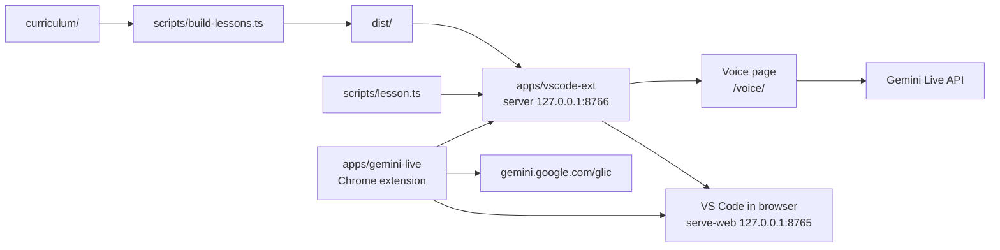
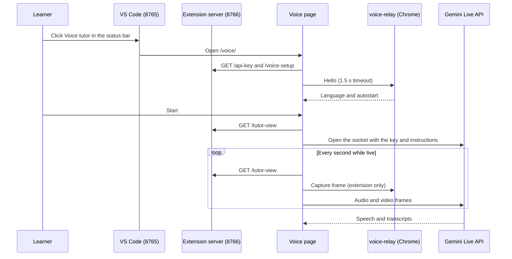

# Architecture

## 1. What the system is

Interview Prep is a local course trainer. Lessons are Markdown files in `curriculum/`, built into HTML pages and opened in VS Code running in the browser (`code serve-web`). Exercises are checked by real tests, and an optional Gemini Live voice tutor reads the lesson and the learner's code. The course content and the tooling are kept apart: `curriculum/` holds lessons and data, while `scripts/` and `apps/` hold the code that builds, serves and checks them.

## 2. The parts

| Part | Owns | Talks to | Entry point |
| --- | --- | --- | --- |
| `curriculum/` | Lessons (`<track>/<NN-slug>/` with `lesson.md`, `starter/`, `solution/`, `tests/`), `tracks.json`, `roles.json`, `path.json`, `_kit/` helpers | Read by `scripts/` only | `curriculum/AUTHORING.md` (the rules), `curriculum/tracks.json` |
| `scripts/` | Build, verify, lesson CLI, start. Shared code in `scripts/lib/` | Reads `curriculum/`, writes `dist/`, `work/`, `.progress/`. Runs the `code` CLI and `vendor/edge-tts-as-extension` | `scripts/start.ts`, `scripts/build-lessons.ts`, `scripts/lesson.ts`, `scripts/verify.ts`, `scripts/narrate-lessons.ts` |
| `apps/vscode-ext` | The VS Code extension: Lessons view, lesson webview, test runs, Gemini key storage, the Voice tutor status item, and a local HTTP server on `127.0.0.1:8766` | Reads `dist/`. Runs `scripts/lesson.ts`. Serves the tutor view, the voice page and the key routes | `apps/vscode-ext/src/extension.ts` |
| `apps/gemini-live` (Chrome extension) | The subscription voice engine: session state, the Gemini window, capture of the VS Code tab, the hardware mic key | The VS Code tab (`vscode-tutor` content script), the `8766` server, `gemini.google.com/glic`, the native mic-key host | `apps/gemini-live/src/entrypoints/background.ts` |
| Voice page (`apps/gemini-live/src/voice/`) | The API key voice engine, as a page that calls Gemini Live itself | The `8766` server (key, tutor view, setup), the Gemini Live WebSocket, and the `voice-relay` content script when the Chrome extension is installed | `apps/gemini-live/src/voice/main.ts`, built by `apps/gemini-live/vite.voice.config.ts` into `apps/gemini-live/.output-voice` |

Caption: the lesson pipeline flows left to right into the extension, which serves the tutor view and the voice page. The Chrome extension reads the same server and drives the Gemini window.

Two ports matter:

- `8765` is the VS Code server that `pnpm start` runs (`SERVER_DEFAULT_PORT` in `scripts/lib/server.ts`).
- `8766` is the extension server (`TUTOR_VIEW_PORT`). It starts when the extension activates, and it listens on `127.0.0.1` only.

## 3. How a lesson reaches the learner

1. **Build.** `pnpm build` runs `scripts/build-lessons.ts`. It reads every lesson with `readLessons` (front matter checked by `lessonMetaSchema`), clears `dist/lessons/`, and writes three files per lesson: `<id>.html` (from `scripts/lib/render.ts`, carrying each card's spoken script in `data-narrate` for the Edge Read Aloud extension to speak), `<id>.tutor.json` (from `scripts/lib/tutor-notes.ts`), and SQL table metadata read from PGlite (`scripts/lib/sql-schema.ts`). It ends by writing `dist/index.json`.
2. **Start.** `pnpm start` runs `scripts/start.ts`. It writes the VS Code machine settings, runs the build, packages `apps/vscode-ext/interview-prep.vsix`, builds the voice page, and installs the extension plus `ms-python.python` into a VS Code server data folder. It creates a connection token once, stops leftover servers that use its data folder, and runs `code serve-web` on `127.0.0.1:8765`. Then it opens `http://127.0.0.1:8765/?tkn=...&folder=...`. The `--dev` flag links the extension folder to the source instead of the installed copy.
3. **Activate.** The extension activates on `workspaceContains:curriculum/tracks.json`. It starts the `8766` server and the Lessons view. If `interviewPrep.autoOpenNextLesson` is on, it opens the next unpassed lesson (`scripts/lib/study.ts`).
4. **Open.** `apps/vscode-ext/src/extension.ts` copies the starter into `work/` (`ensureWorkCopy` in `scripts/lib/run.ts`), opens it on the left, and opens the lesson webview on the right. The webview loads `dist/lessons/<id>.html` (`apps/vscode-ext/src/lessonPanel.ts`).
5. **Test.** "Run My Tests" starts a VS Code task that runs `node scripts/lesson.ts test <id>` (`runTestsInTerminal` in `apps/vscode-ext/src/lessonCli.ts`). Python lessons run `pytest`. Other lessons run `vitest` with the root `vitest.config.ts`. Results go to `.progress/` (`scripts/lib/progress.ts`), and a pass offers the next lesson.

## 4. The two voice engines

Both engines serve the same tutor view and answer to the same Voice tutor controls. The Voice tutor status item in VS Code always opens the voice page. The Chrome extension's chip on the VS Code tab starts a session, and the engine setting picks which one runs (`apps/gemini-live/src/lib/live.ts`, `LIVE_ENGINE`).

| | Subscription engine | API key engine |
| --- | --- | --- |
| Model runs in | Gemini's own web page at `gemini.google.com/glic`, driven by `apps/gemini-live/src/entrypoints/glic.content.ts` | The voice page, over a WebSocket to the Gemini Live API (`apps/gemini-live/src/lib/live-api/defaults.ts`) |
| Needs | The Chrome extension and a Gemini sign-in | The key, from `GEMINI_API_KEY` or VS Code secret storage. The Chrome extension is optional |
| Screen | `captureVisibleTab` of the VS Code tab, cropped to the focus rectangle (`apps/gemini-live/src/lib/capture.ts`) | Frames through the extension when it is installed, otherwise a screen share (`apps/gemini-live/src/voice/SessionCard.svelte`) |
| Context | The brief is typed into Gemini (`apps/gemini-live/src/lib/brief.ts`) | The system instruction is built from the tutor view (`apps/gemini-live/src/voice/tutor-session.ts`) |
| Risk | Google may suspend an account that uses it (`apps/gemini-live/src/lib/engine.ts`) | The official public API, billed to the key |

### Message channels

Each channel has one protocol map and one library. Every incoming payload is parsed with zod.

| Channel | Between | Library | Protocol map |
| --- | --- | --- | --- |
| Extension messaging | Content scripts, background and popup | `@webext-core/messaging`, `defineExtensionMessaging` | `apps/gemini-live/src/lib/extension-channel.ts` |
| Glic bridge | `glic.content` (page world) and `glic-relay.content` (extension world) on `gemini.google.com/glic` | `@webext-core/messaging/page`, `defineCustomEventMessaging`, namespace `interview-prep-glic@1` | `apps/gemini-live/src/lib/bridge-channel.ts` |
| Voice channel | Voice page and `voice-relay.content` | `@webext-core/messaging/page`, `defineCustomEventMessaging`, namespace `interview-prep-voice` | `apps/gemini-live/src/lib/voice-channel.ts` |
| Native messaging | Background and `apps/gemini-live/native/MicKeyHost.cs` | `browser.runtime.connectNative` (not `@webext-core/messaging`) | `apps/gemini-live/src/lib/mic-key.ts` |
| VS Code webview | Lesson webview and extension | `vscode.WebviewPanel` messages | `scripts/lib/panel.ts` |
| Local HTTP | Voice page and Chrome extension, to `8766` | `fetch`, routes in `apps/vscode-ext/src/server/` | `scripts/lib/tutor-view.ts`, `scripts/lib/voice.ts` |

### A voice session with the API key engine

Caption: the page fetches the key and the tutor view from the extension server, then talks to Gemini Live directly. The relay only adds frames and the autostart hint when the Chrome extension is installed.

## 5. Where validation happens

Every boundary parses its input with zod. `scripts/lib/zod.ts` sets `jitless` and re-exports `z`. The apps import their own copy of that re-export (`@/lib/zod.ts`). The server also parses its outgoing JSON in `sendJson` (`apps/vscode-ext/src/server/respond.ts`).

| File | Schemas | Checks |
| --- | --- | --- |
| `scripts/lib/schema.ts` | `lessonMetaSchema`, `quizSchema`, `lastTestSchema`, `tutorNotesSchema`, `progressSchema`, `tracksSchema`, `rolesSchema`, `lessonIndexSchema` | Lesson front matter and quizzes, progress and last test files, `dist/index.json` |
| `scripts/lib/tutor-view.ts` | `tutorBlockSchema`, `tutorViewSchema` | The tutor view served at `/tutor-view`, read by both voice engines |
| `scripts/lib/voice.ts` | `apiKeyResponseSchema`, `apiKeyUpdateSchema`, `voiceSetupSchema` | The `/api-key` and `/voice-setup` routes, on both ends |
| `scripts/lib/panel.ts` | `panelMessageSchema` | Messages from the lesson webview |
| `scripts/lib/query-result.ts` | `queryResultSchema` | Query result lines written by the test runs |
| `apps/gemini-live/src/lib/voice-protocol.ts` | `voiceHelloSchema`, `voiceReportSchema` | Voice page and background messages |
| `apps/gemini-live/src/lib/frame.ts` | `frameSchema` | Captured frames, across all contexts |
| `apps/gemini-live/src/lib/bridge-report.ts` | `glicStateSchema`, `bridgeFailureSchema` | Reports from the Gemini page |
| `apps/gemini-live/src/lib/live-api/messages.ts` | `clientMessageSchema`, `serverMessageSchema` | The Gemini Live wire format, both directions |
| `apps/gemini-live/src/lib/mic-key.ts` | `hostEventSchema` | Native mic-key host events |
| `apps/gemini-live/src/lib/session-schema.ts` | `storedSessionSchema` | The stored session, including older shapes |
| `apps/gemini-live/src/lib/settings.ts` | `languageSchema`, `engineSchema`, `micKeySchema` | Stored settings |

## 6. The verify pipeline

| Command | What runs | Notes |
| --- | --- | --- |
| `pnpm verify [track]` | `scripts/verify.ts`: structure rules from `scripts/lib/validate.ts`, then each solution must pass and each starter must fail | `--structure` skips the test runs |
| `pnpm lint` | `oxlint --type-aware` with the fix config, then `eslint --fix`, then `oxlint` | Scope is the rules in `eslint.config.js` |
| `pnpm stylelint` | `stylelint` on CSS, HTML and Svelte files | `.stylelintrc.json`, with `postcss-html` |
| `pnpm typecheck` | `tsc` on `tsconfig.json` (scripts, curriculum), then `tsconfig.solutions.json` (`dist/solution-overlay`) | Run `pnpm verify` first, so the overlay exists |
| `pnpm fallow` | `fallow audit --base HEAD` | Config in `.fallowrc.json` |
| `apps/vscode-ext`: `pnpm test`, `pnpm build`, `pnpm package` | `vitest run`, `esbuild`, then `vsce package` into `interview-prep.vsix` | `package` also runs the build |
| `apps/gemini-live`: `pnpm test` | `vitest run` on `src/**/*.test.ts` | |
| `apps/gemini-live`: `pnpm compile` | `wxt prepare`, `tsc --noEmit`, `svelte-check` | |
| `apps/gemini-live`: `pnpm test:chain` | `test/run-chain.ts`, an end-to-end run in Chrome for Testing | Needs Chrome for Testing |
| `apps/gemini-live`: `pnpm build`, `pnpm build:voice` | `wxt build` into `.output/chrome-mv3`, and `vite` into `.output-voice` | `pnpm start` runs `build:voice`. The `build` output is the Chrome extension folder that the setup route points to |

`AGENTS.md` asks for `pnpm lint && pnpm stylelint && pnpm typecheck && pnpm fallow` before each commit, plus `pnpm verify` when lessons change. The pre-commit hook (`simple-git-hooks`) runs `lint-staged`, which runs `oxlint` and `eslint` on `scripts`, `apps`, `eslint-rules` and `curriculum/_kit`, and `stylelint` on the app's CSS and Svelte files. The repository has no CI workflow, so these checks run locally.
